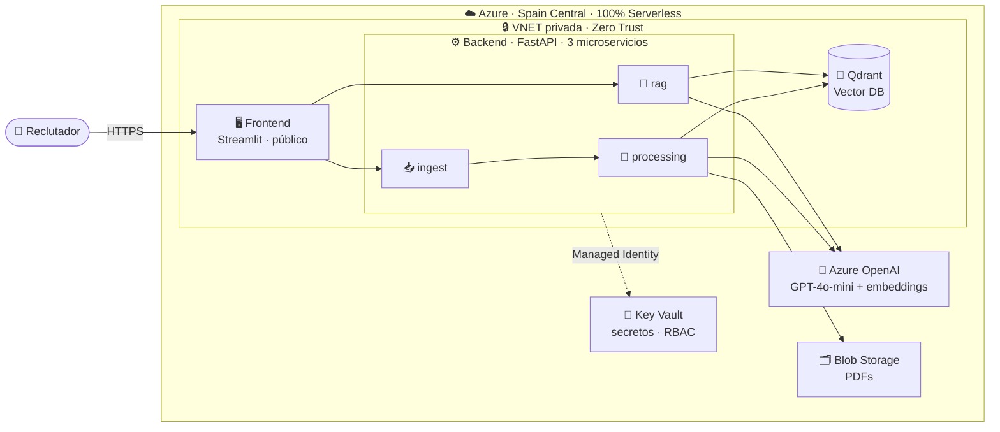
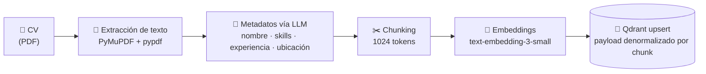
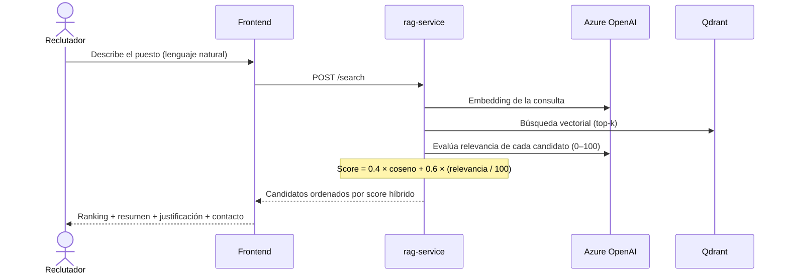

# 🧠 TalentRefine AI

### Motor de búsqueda semántica de talento — _Advanced RAG_ para selección de personal

Sube currículums en PDF y encuentra a los mejores candidatos describiendo el puesto **en lenguaje natural**.
Los resultados se ordenan por un **score híbrido** que combina similitud semántica y evaluación de un LLM.

 

 

---

## 🎯 El problema

Un proceso de selección medio recibe **cientos de CVs** por vacante. Filtrarlos a mano por palabras clave es lento, poco fiable y se pierde el contexto: un CV que dice _"lideré la migración de un monolito a microservicios"_ debería aparecer al buscar _"experiencia en arquitectura cloud"_, aunque no contenga esas palabras exactas.

**TalentRefine AI** resuelve esto con **búsqueda semántica (RAG)**: entiende el *significado* de la oferta y del currículum, no solo las coincidencias literales.

> Describe la vacante como se la contarías a un compañero —
> _"Backend senior con Python, FastAPI y experiencia en Azure, +5 años, en Madrid"_ —
> y el sistema devuelve un **ranking de candidatos** con resumen, justificación de encaje y datos de contacto, todo generado por IA.

---

## ✨ Qué hace

| Funcionalidad | Descripción |
|---|---|
| 📤 **Ingesta de CVs** | Carga múltiple de PDFs con drag & drop; seguimiento de estado por documento; panel de candidatos indexados |
| 🔎 **Búsqueda en lenguaje natural** | Consulta libre + filtros de experiencia mínima, ubicación y skills |
| 🏆 **Ranking inteligente** | Candidatos ordenados por **score híbrido** (semántico + relevancia LLM), con resumen y justificación de encaje |
| 📇 **Extracción automática** | Nombre, email, teléfono, ubicación, años de experiencia y skills extraídos del CV por IA |

---

## 🏗️ Arquitectura

Sistema **Cloud Native, 100% serverless**, desplegado en **Azure Container Apps** (Spain Central) con **seguridad Zero Trust** e **infraestructura como código** (Terraform).

- **Frontend (Streamlit)** — única pieza expuesta a Internet.
- **Backend (FastAPI)** — tres microservicios independientes, cada uno con su Dockerfile: `ingest` (recibe PDFs), `processing` (extrae, vectoriza e indexa) y `rag` (búsqueda + scoring).
- **Qdrant** — base de datos vectorial con persistencia en Azure File Share.
- **Servicios PaaS** — Azure OpenAI, Blob Storage y Key Vault, todos accesibles solo por red privada mediante **Private Endpoints**.

---

## ⚙️ Cómo funciona

### 1️⃣ Ingesta e indexación de un CV

### 2️⃣ Búsqueda y ranking de candidatos

> **🔑 Score híbrido:** la similitud vectorial (coseno) encuentra los candidatos *parecidos*; el LLM juzga cuáles son realmente *relevantes* para el puesto. La combinación `0.4 · coseno + 0.6 · relevancia` aprovecha lo mejor de ambos mundos.

---

## 🧰 Stack tecnológico

| Capa | Tecnologías |
|------|-------------|
| **Frontend** | Streamlit · Docker |
| **Backend / API** | Python · FastAPI · uvicorn · Pydantic · structlog |
| **IA / RAG** | LlamaIndex · Azure OpenAI (`gpt-4o-mini`, `text-embedding-3-small`) |
| **Datos** | Qdrant (vector DB) · Azure Blob Storage · Azure File Share |
| **Infraestructura** | Terraform · Azure Container Apps · VNET · Private Endpoints · Key Vault · Managed Identity |
| **Observabilidad** | Application Insights · Log Analytics |

---

## 💡 Decisiones de ingeniería destacadas

- **🔐 Zero Trust — cero credenciales en texto plano.** Toda la autenticación entre servicios usa **Managed Identity + RBAC**; los secretos viven en **Key Vault**. Nada de connection strings ni contraseñas hardcodeadas.
- **💸 FinOps — ~6–9 €/mes.** Todo escala a cero (`min_replicas = 0`): sin tráfico, sin coste. SKUs mínimos y `gpt-4o-mini` reducen el gasto ~80 % frente a GPT-4. Con 100 € de crédito de estudiante: **~11–16 meses** de operación.
- **🧩 Metadatos denormalizados en Qdrant.** El LLM extrae los metadatos del candidato **una sola vez** y se replican en cada chunk, de modo que la búsqueda siempre devuelve información completa independientemente de qué fragmento haga match.
- **⏱️ Processing síncrono + semáforo.** `asyncio.Semaphore(1)` serializa los CVs dentro de cada réplica para no saturar el límite de TPM de Azure OpenAI, y el endpoint síncrono evita que Container Apps mate la réplica (scale-to-zero) con trabajo a medias.
- **🏗️ Infraestructura 100 % como código.** 28 archivos Terraform modulares (networking, security, storage, ai, compute, monitoring, private endpoints) — reproducible con un `terraform apply`.

---

## 📦 Repositorios

| Repositorio | Descripción | Stack |
|-------------|-------------|-------|
| **[TalentRefineAI-Frontend](https://github.com/TalentRefineAI/TalentRefineAI-Frontend)** | Interfaz de usuario: subida de CVs, búsqueda y resultados | Streamlit |
| **[TalentRefineAI-Backend](https://github.com/TalentRefineAI/TalentRefineAI-Backend)** | Microservicios de ingesta, procesamiento y RAG | FastAPI · LlamaIndex · Qdrant |
| **[TalentRefineAI-Infra](https://github.com/TalentRefineAI/TalentRefineAI-Infra)** | Infraestructura como código en Azure | Terraform |

---

### 🎓 Trabajo de Fin de Máster

Proyecto desarrollado bajo los paradigmas **Cloud Native**, **Serverless**, **FinOps** y **Seguridad por diseño (Zero Trust)**.

**[🚀 Probar la demo en vivo](https://ca-frontend-talentrefine-dev-spc.greenwave-4d796cb5.spaincentral.azurecontainerapps.io)**

Licencia MIT

